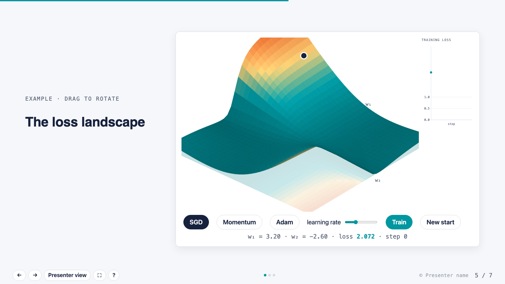
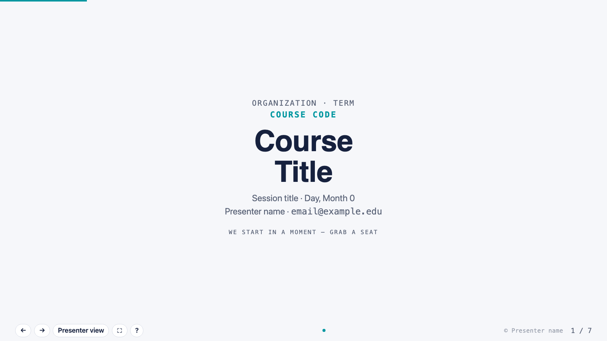
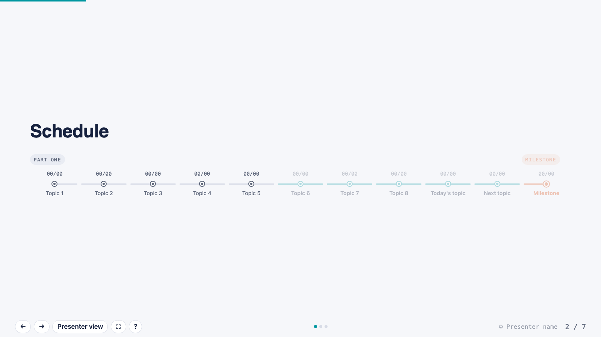
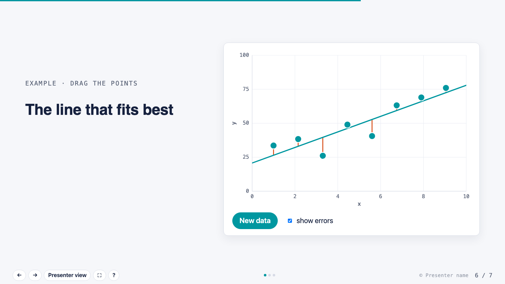
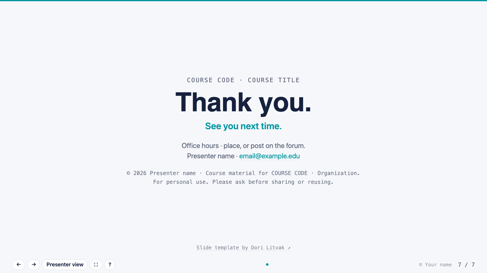

# HTML Slide Template

Tired of fighting slide software? This is a single HTML file that looks and works like a real presentation tool, with a presenter view, speaker notes and live interactive figures. You build and edit the whole deck just by asking your AI coding agent (Claude Code, Cursor, Copilot…). No build step, no install. Open it in a browser and present.

**[▶ Try the live demo](https://dorlitvak.github.io/best-html-slide-template/)**

## Features

- **Edit by asking.** Tell your AI agent "add a slide about X with a chart" or "rewrite my notes for slide 4". Slides, notes and figures are plain HTML, so the agent can change anything.
- **Step-by-step reveals.** Bullets, figures and highlights appear one press at a time.
- **Presenter view.** Press <kbd>P</kbd> to open a second window with the current slide, your speaker notes and a clickable list of every slide. The two windows stay in sync.
- **Interactive figures.** The examples include a 3D loss surface you can rotate and train on (SGD, Momentum, Adam), and a scatter plot where you drag points and the best-fit line follows.
- **Light and dark mode** that follow the viewer's system setting.
- **A single file.** Share it, drop it in a course page or host it anywhere. The only network request is for Google Fonts.

| | |
|---|---|
|  |  |
|  |  |

## Quick start

1. Download [`Slide Template.html`](Slide%20Template.html) (or clone the repo).
2. Open it in Chrome, Edge, Firefox or Safari.
3. Edit the placeholder text (`COURSE CODE`, `Course Title`, `Presenter name`, …) in any text editor.

## Keys

| Key | Action |
|---|---|
| <kbd>→</kbd> / <kbd>Space</kbd> | Next step (or next slide) |
| <kbd>←</kbd> | Previous step / slide |
| <kbd>↓</kbd> <kbd>↑</kbd> | Next / previous slide |
| <kbd>P</kbd> | Presenter view |
| <kbd>F</kbd> | Fullscreen |
| <kbd>?</kbd> | Help |

## Making your own slides

- Each slide is a `<section class="slide" data-steps="N">`.
  - `class="one"` gives a single column.
  - `class="wide"` gives narrow text and a wide figure.
  - No class gives text on the left and a figure on the right.
- `data-steps="N"` is how many presses the slide takes. An element with `data-step="k"` appears at press *k*.
- Speaker notes go in `
` at the end of a slide.
- If you have two decks open at once, give each one its own channel name (search the file for `CHANNEL`).

There are more notes in the comment at the top of the HTML file.

## License

[MIT](LICENSE). Free to use, change and share. Keep the copyright notice from `LICENSE`, and a link back to this repo is appreciated.

Made by [Dori Litvak](https://github.com/DorLitvak).
